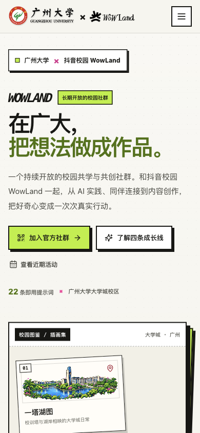
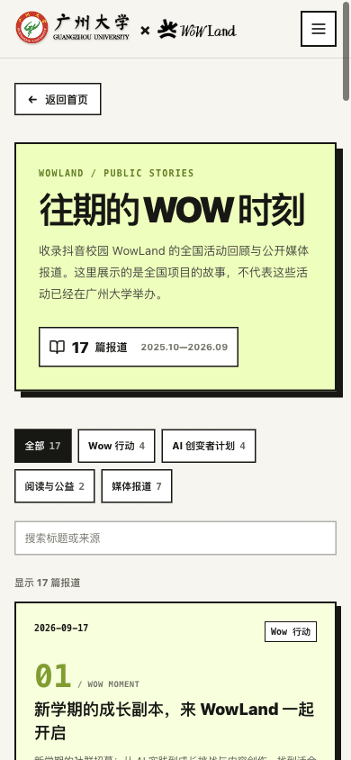

# 广州大学 × 抖音校园 WowLand

广州大学校园里的 WowLand 长期共学与共创社群网站。网站以像素插画、校园图鉴和轻量互动呈现四条成长线、活动形式、近期活动、往期公开报道与校园场景提示词，适配手机与桌面浏览。

<p align="center">
  
  
</p>

## 页面内容

- **校园首页**：广州大学与 WowLand 联合视觉、像素风校园图鉴、活动入口和社群二维码。
- **四条成长线**：AI 实践与创变、职业发展与连接、野生创作 Camp、学习资源共建。
- **活动形式**：介绍社群持续探索的共学、挑战、共创与交流形式；具体安排以社群通知为准。
- **近期活动**：10 月 24 日活动以精简卡片呈现，点击后展开时间、地点、体验及视频链接。
- **往期回顾**：收录 17 篇抖音校园 WowLand 与公开媒体报道，可按类别筛选和搜索，并跳转原文。
- **AI 生产力宝典**：按学习、编程、设计、求职和校园场景浏览提示词，支持搜索、筛选和一键复制。
- **响应式布局**：适配移动设备和桌面浏览器；页面无需后端即可构建。

## 本地运行

需要 Node.js 18 或更高版本。

```bash
npm install
npm run dev
```

生成静态文件：

```bash
npm run build
```

构建产物位于 `dist/`，可用任意静态文件服务器预览：

```bash
npm run preview
```

## 技术栈

| 部分 | 技术 |
| --- | --- |
| 前端 | React 18 |
| 构建 | Vite 5 |
| 样式 | Tailwind CSS 3、原生 CSS |
| 图标 | Lucide React |
| 内容数据 | JSON 与本地静态资源 |

## 项目结构

```text
src/
├── components/       # 页面区块、导航、二维码与提示词组件
├── data/
│   ├── event.json    # 活动时间与校园影像链接
│   ├── prompts.json  # 提示词分类与内容
│   └── reports.js    # 往期公开报道标题、摘要与原文链接
├── utils/            # 倒计时、剪贴板与筛选逻辑
├── App.jsx
└── index.css
public/
├── assets/           # 页面使用的校园插画与 WowLand 视觉素材
├── qr_douyin.png     # 社群二维码
└── favicon.svg
docs/screenshots/     # 页面截图
```

## 内容与素材

公开仓库仅包含网站当前使用的页面、展示内容和素材。团队花名册、飞书知识库链接、内部策划文件和测试资料不在仓库中。

校园照片与插画的素材来源记录在 [`public/assets/ASSET_SOURCES.md`](public/assets/ASSET_SOURCES.md)。学校标识、WowLand 与合作方视觉素材的权利归各自权利人所有；使用或转载前请遵守其授权要求。

往期回顾记录的是全国 WowLand 项目的公开报道，并不代表这些活动已在广州大学举办。报道标题、发布日期及来源来自公开页面，摘要由本站整理，文章内容版权归原发布者所有。

## 说明

本仓库用于展示和维护网站源代码。向 GitHub 上传源代码不会自动发布网站，也不会配置「奶蛙.club」或任何托管服务。
